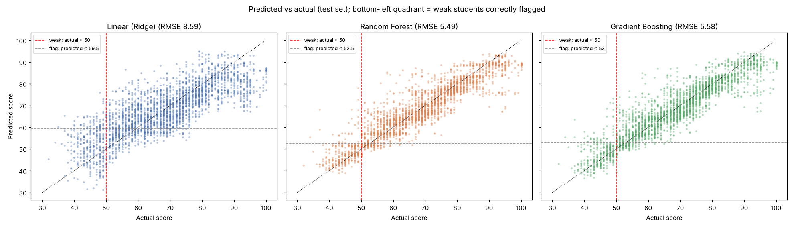
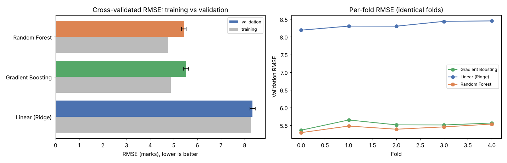

# O-level Mathematics Score Prediction

Predicts each student's O-level mathematics score so a school can **identify weaker students before the exam** and
offer them support. Three model architectures are tuned and compared on accuracy, on how well they find weak
students, and on robustness; the best is selected by a rule declared in the config and saved with a model card for
scoring new cohorts.

**Result:** Random Forest is selected. On 2,912 unseen students it predicts scores to within ±3.9 marks on average
(R² 0.85) and, flagging students predicted below 52.5, **finds 91% of the students who score below 50** (317 of
348), with 7 in 10 flagged students genuinely weak.

---

## Project structure

```
├── main.py                     # CLI: validate | train | predict
├── configs/
│   ├── config.yaml             # every setting: data rules, features (incl. excluded ones and why), models,
│   │                           #   search spaces, weak-student definition, selection rule, artifacts
│   └── fast.yaml               # quick profile (extends config.yaml), runs in ~10 s
├── src/
│   ├── config.py               # YAML loading, profile inheritance, validation of every value
│   ├── schema.py               # schema validation of raw input and of cleaned data
│   ├── data.py                 # loading, duplicate merging, cleaning, data fingerprint, stratified split
│   ├── features.py             # sleep duration, class size/ratio; preprocessing (imputation, encoding, splines)
│   ├── models.py               # model definitions, search spaces from config, hyperparameter tuning
│   ├── evaluation.py           # regression + weak-student metrics, paired CV, bootstrap, selection
│   ├── train.py                # end-to-end training pipeline
│   ├── predict.py              # scoring new students with a saved model
│   ├── artifacts.py            # versioned run folders, model card, export of a committed summary
│   ├── plots.py                # figures saved with each run
│   └── logging_utils.py        # console + per-run log file
├── tests/                      # 56 pytest tests (unit + end-to-end), ~7 s
├── notebooks/
│   └── olevel_report.ipynb     # assumption checks, EDA and results report (reads run artifacts)
├── reports/latest_run/         # committed summary of the reference run: metrics, plots, model card, log
├── data/student_scores.csv     # dataset (15,900 records)
├── .github/workflows/tests.yml # CI: tests + data validation on every push
├── pyproject.toml
└── requirements.txt
```

The notebook contains **no pipeline code**: it imports `src/` and reads saved run artifacts, so the analysis and
the production code cannot drift apart.

## Quick start

```bash
pip install -r requirements.txt

python -m pytest                                   # 56 tests, ~7 s
python main.py validate                            # schema check of data/student_scores.csv
python main.py --config configs/fast.yaml train    # smoke run, ~10 s (results not reported)
python main.py train                               # full run, ~2 min
python main.py predict --input students.csv --output scored.csv
```

`predict` accepts the training-file format (`final_test` optional) and writes `student_id`, `predicted_score` and
`flag_for_support`, **sorted from the lowest predicted score**. Exit codes: `0` success, `1` data/schema error,
`2` configuration error.

## Assumptions and how they were verified

The brief warns that some features may be synthetic, and the attribute descriptions were not supplied, so every
assumption is tested in [`notebooks/olevel_report.ipynb`](notebooks/olevel_report.ipynb) (Section 3):

| # | Assumption | Evidence | Action |
|---|---|---|---|
| A1 | Repeated `student_id`s are the same student | 900 IDs appear exactly twice and agree on **every** attribute except `bag_color`; apparent differences in score/attendance are one copy being missing | Merge pairs, keep the first non-missing value |
| A2 | **`bag_color` is synthetic** | Same student has a different bag colour in 729 of 900 pairs (81%); no score difference by colour (ANOVA p = 0.24) | Excluded |
| A3 | Gender, transport, wake time, age carry no signal | p = 0.18, 0.84, 0.91, 0.82; group means within 0.4 marks | Kept (plausible real attributes); models give them ~0 importance |
| A4 | Missing `CCA` means no CCA | Missing scores like "None" (76.8 vs 76.7, KS p = 0.64) and unlike any CCA (64.0) | Recode to "None" |
| A5 | Ages 5/6 are typos for 15/16 | Same score distributions (KS p = 0.77 and 0.14); O-level candidates are 15–16 | +10; 5 negative ages set to missing |
| A6 | `Y`/`N` = Yes/No; `CLUBS` = Clubs | Matching score means | Standardised |
| A7 | Bedtimes 00:00–03:00 are after midnight | Wake times 05:00–07:00 give 4–8 h of sleep, 92% exactly 8 h | `sleep_hours`, `sleep_after_midnight` |
| A8 | Missing `attendance_rate` is uninformative | Mean score 67.5 when missing vs 67.2 present | Median imputation + missing indicator |
| A9 | `n_male`/`n_female` describe the student's class | Totals 14–31; larger classes score lower | `class_size`, `male_ratio` |
| A10 | Linear model's weakness is **interactions**, not curves | Additive boosted trees (depth 1) reach RMSE 8.1, like spline Ridge (8.3); allowing interactions → 5.5 | Explains the model ranking |

Students with no `final_test` (441 after merging) are dropped from training.

## Key drivers (EDA)

- **Class size** and **number of siblings** (and their interaction): an only child scores about 78 in classes of up
  to 25; a student with one sibling drops from 80 to 64 when the class grows past 20.
- **Study hours are step-shaped:** 0–4 h ≈ 46, 5–9 h ≈ 72, 11+ h ≈ 61.
- **Attendance below 80%** ≈ 45 marks vs 64–69 above.
- **Sleeping after midnight** ≈ 45–53 vs 68.
- **No CCA** +13, **visual learners** +8, **tuition** +8, **direct admission** +7.

## Method

1. **Split:** 80/20, stratified on weak (< 50) vs not, so both sets have the same share of weak students.
2. **Models:**
   | Model | Architecture | Tuned settings (selected) |
   |---|---|---|
   | Linear (Ridge) | L2-regularised linear regression; search may add cubic splines | splines with 10 knots, α = 0.075 |
   | Random Forest | Bagged deep regression trees | 258 trees, max depth 10, 60% of features per split |
   | Gradient Boosting | Boosted shallow trees (`HistGradientBoostingRegressor`) | 587 iterations, learning rate 0.024, 32 leaves |
3. **Tuning:** randomised search, 3-fold CV, RMSE, training data only.
4. **Comparison:** 5-fold CV on identical folds with paired t-tests; held-out test set with bootstrap 95% CIs.
5. **Weak students:** "weak" = actual score < 50 (C6 credit pass). A student is **flagged** if predicted < cut-off;
   the cut-off maximises **F2** (recall counts twice as much as precision, since missing a weak student is worse
   than offering extra help) on out-of-fold training predictions.
6. **Selection rule (config):** lowest mean CV RMSE; models within 1% are tied and the tie is broken by F2.

## Results

Reference run `final` (full summary in [`reports/latest_run/`](reports/latest_run/)):

| | Linear (Ridge) | **Random Forest** | Gradient Boosting |
|---|---|---|---|
| CV RMSE (± sd) | 8.34 ± 0.11 | **5.43 ± 0.09** | 5.52 ± 0.11 |
| Train–validation gap | 0.06 (under-fits) | 0.66 | 0.63 |
| Test RMSE / MAE | 8.59 / 6.77 | **5.49 / 3.90** | 5.58 / 4.00 |
| Test R² | 0.633 | **0.850** | 0.846 |
| Predictions within 5 marks | 46% | **74%** | 72% |
| RMSE for weak students | 10.83 | **5.96** | 6.29 |
| Flag cut-off (predicted <) | 59.5 | 52.5 | 53.0 |
| Weak students found (recall) | 83% (288/348) | **91% (317/348)** | 87% (302/348) |
| Precision of flags | 41% (416 false alarms) | **69%** (141) | 67% (150) |
| F2 | 0.687 | **0.857** | 0.819 |



**Comparison**
- **Linear is clearly unsuitable:** about 3.1 marks worse RMSE (95% CI 2.9–3.3), worse on every fold
  (p < 0.001), and to catch weak students it raises 3× as many false alarms. It under-fits because the data
  contains strong interactions (A10).
- **Random Forest beats Gradient Boosting narrowly but consistently:** better on all 5 CV folds (p = 0.025), test RMSE
  −0.08 marks (95% CI −0.16 to −0.0003), and, more importantly for the school, **+4.2 points of weak-student recall**
  (95% CI +1.9 to +6.8): 15 more weak students identified on the test set, with fewer false alarms.
- All models over-predict the weakest students (regression to the mean, about +4.6 marks below 45), which is why
  the selected flag cut-off (52.5) sits above the weak threshold of 50.



**Recommendation:** use the **Random Forest** with a flag cut-off of 52.5. Gradient Boosting is an acceptable
alternative; use the linear model only if a fully transparent formula is required, at a large cost in accuracy.

## How the school can use it
- Score each new cohort early in the year (`python main.py predict`); start with the lowest predicted scores.
- For flagged students, check the actionable drivers: **attendance below 80%**, **sleeping after midnight**, **very
  low weekly study hours**.
- Treat predictions as screening, not a label: review with teachers, and retrain each year with the new results.

## Limitations
- Typical error is ±4 marks; borderline students near the cut-off should be reviewed individually.
- One school's data; re-validate before use elsewhere.
- `gender` is among the predictors (it contributes ~0); review fairness before deployment and consider removing it.
